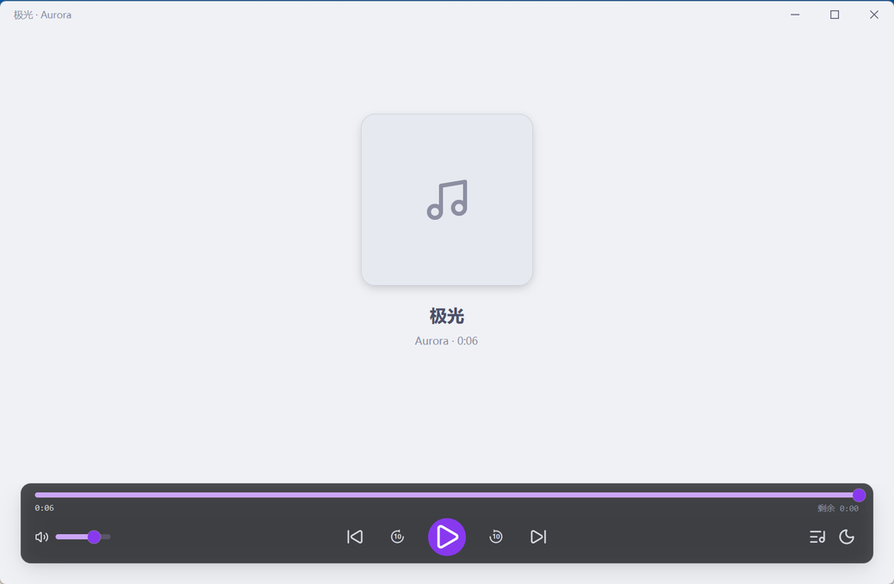
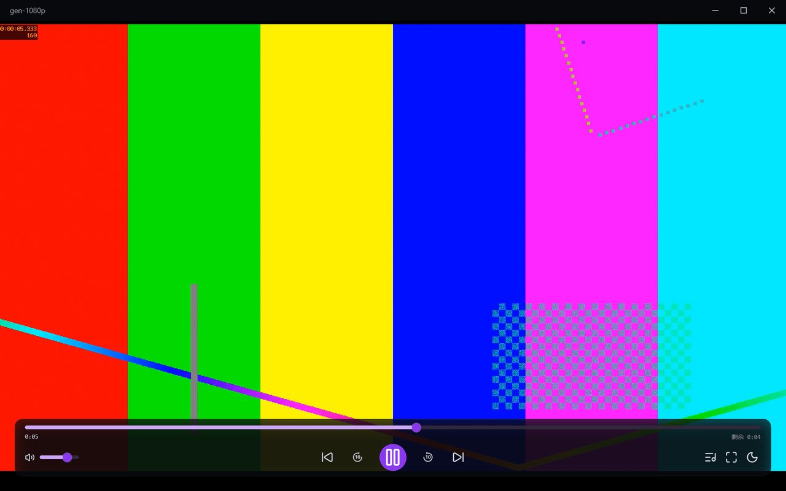

# Simple Media Player

一个用 Rust + [GPUI Kit](https://gpui-kit.com) 写的轻量桌面媒体播放器：单窗口、原生渲染、启动快，
音频走 [rodio](https://github.com/RustAudio/rodio)，视频交给 mpv。

窗口标题用设计稿的产品名 **Chroma**（仓库/二进制名沿用 `simple-media-player`）。
界面按设计稿的 **IINA 式沉浸布局**：内容占满窗口，控制条是一块悬浮的深色玻璃胶囊，
播放列表默认收起。应用表面严格对齐 **Catppuccin Latte** 色板（深色模式 **Mocha**），
强调色只用 **Mauve `#8839EF`** 一个；悬浮叠加层单独一套深色玻璃色值。两套映射都集中在
`crates/app/src/theme.rs`，改一处即整体换肤。



## 功能

| 能力 | 说明 |
|---|---|
| 音频播放 | MP3 / FLAC / WAV / OGG / M4A / AAC 等（rodio 解码） |
| 视频播放 | MP4 / MKV / WebM / MOV / AVI / TS 等（mpv 硬解，`hwdec=auto-safe`） |
| 播放列表 | 添加文件 / 递归扫描文件夹、拖拽排序、删除单曲、清空、双击播放；面板悬浮、一键开合 |
| 命令行直开 | `simple-media-player.exe D:\movie.mp4`（或 `--play <路径>`）加入列表并立即播放 |
| 拖放导入 | 从资源管理器拖文件/文件夹进窗口：入列表并立刻播第一个（文件夹递归扫描），结果用一条提示回执 |
| 自动连播 | 一曲结束自动下一首；播完列表末尾停止 |
| 进度与音量 | 拖动进度条跳转、音量 0–100 实时生效 |
| 影院模式 | 视频播放时一键全屏并隐藏歌单，退出自动恢复 |
| 明暗主题 | 右上角一键切换，配色全部走主题 token |
| 状态持久化 | 播放列表、上次曲目、音量、窗口尺寸自动保存 |
| 错误提示 | 文件损坏、格式不支持、mpv 缺失等都有提示：音频模式走右上角 toast，视频模式走标题带胶囊 |
| 无障碍 | 所有图标按钮都有可读名称（`aria_label`） |



## 环境要求

- **Windows 10 / 11**（当前只验证了 Windows；GPUI Kit 本身跨平台，代码里 macOS/Linux 分支未测试）
- **mpv**（仅视频播放需要）：任选一种方式
  - 安装到 PATH
  - 放到 `C:\Program Files\mpv\mpv.exe`
  - 用环境变量指定：`set SMP_MPV_PATH=D:\tools\mpv.exe`

音频功能不依赖 mpv；mpv 缺失时视频区会显示明确提示，不影响其他功能。

## 快速开始

```powershell
# 1. 拿到发布包后解压，直接运行
.\simple-media-player.exe

# 2. 首次使用：点右下角的列表按钮展开播放面板，用它右上角的「+」添加文件，或「📂」递归添加整个文件夹

# 3. 点列表项开始播放（列表默认收起，随时可再点列表按钮开合）
```

带 mpv 的发布包（解压即用，无需另外安装 mpv）：

```powershell
powershell -ExecutionPolicy Bypass -File scripts/package.ps1 -WithMpv
```

> mpv 采用 GPL 许可，随包分发前请自行确认许可合规性。默认打包（不加 `-WithMpv`）不包含 mpv。

## 从源码构建

```powershell
cargo build --release -p simple-media-player
# 产物：target\release\simple-media-player.exe
```

开发运行：

```powershell
cargo run -p simple-media-player                 # 浅色主题启动
cargo run -p simple-media-player -- --dark       # 深色主题启动
cargo run -p simple-media-player -- D:\movie.mp4 # 打开即播（也支持 --play <路径>）
```

`--play <文件>` / 直接给位置参数等同于资源管理器的「打开方式」：文件会加进播放列表
（已在列表里就复用那一条）并立即开播。

## 测试

```powershell
cargo test --workspace
```

双轨测试：

- **`crates/player-core`**：纯逻辑与内核。包含真实 mpv 的 IPC 端到端用例（起播 → 进度推进 → 暂停冻结 → 恢复/seek/音量 → 关闭），
  以及 1080p 素材驱动的解码路径。
- **`crates/app/src/ui_tests.rs`**：`gpui_kit::test` 无头窗口 UI 集成测试。用原生指针事件点真实按钮，
  断言播放状态、进度条量程、无障碍名称、主题切换与控件不溢出窗口。

UI 测试把持久化目录重定向到临时目录（见 `persistence::set_config_dir_for_test`），不会污染真实配置。

## 故障排查

| 现象 | 排查方式 |
|---|---|
| 视频区提示找不到 mpv | 设置 `SMP_MPV_PATH` 指向 `mpv.exe`，或安装 mpv 后重启应用 |
| 视频打不开、日志只有一句 toast | 设 `SMP_MPV_LOG=%TEMP%\mpv.log` 后重试，mpv 的真实报错在里面 |
| 想确认命令/事件是否正常 | 设 `SMP_MPV_TRACE=%TEMP%\ipc.log`，逐行记录 IPC 收发 |
| 应用是否被外部结束 | 看 `%APPDATA%\simple-media-player\session.log`：有 `event loop returned` 是正常退出，只有 `start` 说明被强杀 |
| 播放失败但界面上只闪了一下提示 | 同一条错误也写进了 `session.log`（`error: 无法播放「…」…`），可以直接翻日志 |

> 发布版是 GUI 子系统程序，**双击 exe 不会带出一个黑底 cmd 窗口**；代价是它没有控制台，
> 所以诊断信息除了弹 toast，还会同时落到 `session.log`。调试构建保留控制台，`eprintln!` 直接可见。

> 踩过的坑：`playlist.json` 里写成 `C://Users//...`（双斜杠）会导致 mpv 报 `loading failed`，
> 应用会提示「mpv 无法加载该文件」。路径用标准 `C:\Users\...` 即可。

## 数据与日志

配置目录：`%APPDATA%\simple-media-player\`

| 文件 | 内容 |
|---|---|
| `playlist.json` | 曲目列表 + 上次播放位置 |
| `settings.json` | 音量、窗口尺寸 |
| `session.log` | 启动 / 退出 / panic / 播放失败原因留痕（用于区分「主动退出」与「被外部终止」） |

## 架构

```
crates/
├── app/                 # GPUI 应用：窗口、视图状态、播放列表、顶层叠加窗口
│   ├── player_view.rs   # 主区域 + 底部控制栏 + 双引擎路由 + 100ms 状态轮询
│   ├── playlist.rs      # 列表 delegate（虚拟滚动、拖拽排序）
│   ├── theme.rs         # 设计稿色板 → gpui-component 主题 token（Latte / Mocha）
│   ├── video_overlay.rs # Win32 顶层叠加窗口（纯 FFI，无额外 crate）
│   └── persistence.rs   # 配置与会话日志
└── player-core/         # 播放内核（无 UI 依赖）
    ├── audio.rs         # rodio：play/pause/seek/volume
    ├── video.rs         # mpv 子进程 + JSON IPC
    └── metadata.rs      # lofty 元数据、目录扫描
```

### 视频为什么要单独开一个叠加窗口

GPUI 的 Windows 后端使用 DirectComposition（`WS_EX_NOREDIRECTIONBITMAP`），**无法在自己的窗口里承载原生子窗口**，
所以「把 mpv 渲染进 GPUI 窗口」这条路走不通。

实际方案：

1. 应用创建一个 `WS_POPUP` 顶层窗口（owner = 主窗口），不带激活、不进任务栏；
2. mpv 用 `--wid=<该窗口句柄>` 直接把硬解帧画上去，Rust 侧零像素搬运；
3. GPUI 每帧用 `canvas` 回调报告视频区矩形，叠加窗口据此 `SetWindowPos` 跟随（缩放、全屏、影院模式都跟随）；
4. 播放控制走 mpv 的 JSON IPC 命名管道。

代价：视频区内的 GPUI 元素会被叠加窗口盖住（当前 UI 在该区域没有浮层，所以无影响）。

> 踩坑记录：Windows 命名管道上挂起的 `ReadFile` 会阻塞 `WriteFile`（即使句柄是 `try_clone` 出来的），
> 所以 IPC 不能「读线程 + 写线程」并发，必须单线程串行 + `PeekNamedPipe` 非阻塞探测。
> 详见 `crates/player-core/src/video.rs` 模块注释。

### 拖放为什么要两条接收路径

拖进来的文件有两条落地路径，因为叠加窗口把窗口 80% 的面积盖住了：

1. **GPUI 自己的 `IDropTarget`**（注册在主窗口上）覆盖标题带、控制条、歌单面板这些**没有**被
   叠加窗口遮住的区域：`.on_drop::<ExternalPaths>(...)` 挂在根节点上，整窗都是投放区。
2. **叠加窗口自己收**：OLE 查找投放目标是由 `WindowFromPoint` 从光标下的窗口沿父链向上的，
   走到叠加窗口就断了（GPUI 的 target 在主窗口上，够不到）。所以叠加窗口调
   `DragAcceptFiles(hwnd, TRUE)`，由系统把投放转成 `WM_DROPFILES`，wndproc 里
   `DragQueryFileW` 取出路径丢进队列，主线程 100ms 的 tick 再统一消费。

两条路径最终都汇进 `PlayerView::import_dropped`：文件夹递归扫描 → 按 `path_key`
（`\` 与 `/` 归一化）去重 → 追加进列表 → 播第一个。

## 视觉规范（对齐设计稿）

设计稿（Ardot `737444551354649`）定的是 **IINA 式沉浸布局**：画面/封面占满窗口，
控制条是一块悬浮的深色玻璃胶囊，播放列表默认收起、需要时浮在画面右侧。

### 两套色板（不要混用）

| 层 | 取色依据 | 用在哪 |
|---|---|---|
| **应用表面** | Catppuccin **Latte**（深色 **Mocha**） | 窗口底、悬浮歌单面板 |
| **叠加层** | 深色玻璃 `#0B0C10` @72% + 白 10% 描边 | 悬浮胶囊与其上的一切控件 |

叠加层是**故意不跟主题走**的：它浮在视频画面之上，必须永远偏深，否则浅色主题下
白底控制条会糊在亮画面上（OSC 的通用做法，IINA 同样如此）。`theme.rs` 的
`overlay` 模块集中提供这组颜色（`canvas` / `glass` / `border` / `fg` / `dim` /
`accent` / `play`），界面代码不写死色值。

应用表面的语义 token（`theme.rs` 把设计稿色板翻译成 gpui-component token）：

| 角色 | Token | Latte | 用在哪 |
|---|---|---|---|
| 墙体 | `background` | `#EFF1F5` | 窗口底、悬浮歌单面板 |
| 次级面 | `muted` / `secondary` | `#E6E9EF` | 封面占位、ghost 悬停底 |
| 分隔线 | `border` | `#CCD0DA` | 面板描边、列表分隔 |
| 主文案 | `foreground` | `#4C4F69` | 标题、面板中的曲名 |
| 辅助文案 | `muted_foreground` | `#8C8FA1` | 编号、时长、提示 |
| 强调 | `primary` | `#8839EF` | 播放按钮、当前曲目 |

深色模式用同一结构的 **Mocha**（`#1E1E2E` / `#CBA6F7`），叠加层进度与音量用
Mocha Mauve `#CBA6F7`，播放键仍是品牌色 `#8839EF`。

### 尺寸

自定义标题带 **34px**（自绘拖动区 + 最小化/最大化/关闭，窗口按钮 **46 宽 × 标题栏高**，
字形是手写 10×10 SVG）、悬浮胶囊内缩 **24px**（圆角 12、padding 16×8、行距 4）、
播放列表 **320px** 宽（顶部 40、右侧 12、底部让开胶囊）、播放按钮 **44 正圆**、
正文字号 13 / 辅助 11 / 时间码用等宽 10。
控制行分三段：左端音量、**中间走带控制恒在窗口正中**、右端列表 / 影院 / 换肤
（左、中、右三栏等宽，见 `transport_controls_are_horizontally_centered` 用例）。

胶囊高度按「占窗口多少」调，不按像素堆：三条横排控件加 padding 曾经撑到 107 高
（680 高窗口的 15.7%），远看像压在下沿的一块黑板；现在约 90（13%），
`BOTTOM_BAND` 也相应收到 116。窗口按钮不能沿用 `xsmall` 图标按钮（20×20）——
Windows 的点击热区就是 46 宽整块，图标 10px，悬停铺满底色、关闭键用系统红 `#C42B1C`。

标题带的前景色**跟着底色走**，不跟主题走：视频模式下这条带压在深色画布上，
若还取浅色主题的 `muted_foreground`，对比度只有 3:1 左右，曲名和窗口按钮几乎看不见
（`chrome_fg` / `chrome_dim`）。

提示（toast）分两种呈现，按**底色**而不是按内容选：

| 模式 | 呈现 | 位置 |
|---|---|---|
| 音频 | gpui-component 通知层（会自己排队、可手动关） | 右上角，让开标题带 12px，宽 320 |
| 视频 | 标题带里的小胶囊（浅色文案 + 状态图标，4s 自动退场） | 标题带右侧、窗口按钮左边 |

原因是视频模式的内容区整块被 mpv 叠加窗盖着，in-app toast 画在那里等于没画。
通知层的默认位置（`TITLE_BAR_HEIGHT + 16`）会贴住窗口按钮下沿，宽度 382 在 1040 窗口里
占 37%，所以 `theme::install` 里把 `margins.top` 改成「标题带 + 12」、宽度收到 320。

### 与设计稿的两处刻意偏差

都源自「mpv 渲染在独立顶层窗口、会盖住同区域的 GPUI 控件」这个架构约束：

1. **视频画面上沿/下沿让出控制区**：画面只占「标题带以下、胶囊以上」，胶囊落在
   深色画布上而不是压在画面上。
2. **视频模式展开歌单时画面右侧让位**（让出 344px），否则悬浮面板会被 mpv 整个盖住。

另外设计稿控制行右侧的 CC / 音轨 / 设置 / PiP 图标本版本没有对应功能，因此不画。

## 已知限制

- **视频区不可绘制 GPUI 浮层**：受上面的架构约束。将来要做字幕/控件浮层需要改纹理共享方案。
  因此视频模式的一切反馈都只能落在标题带上：拖放提示是一枚小胶囊（全窗卡片会被叠加窗挡住），
  操作回执/错误也是标题带胶囊（见上面的呈现表）。
- **进度条与音量条只支持鼠标拖动**：上游 `Slider` 组件尚未实现键盘操作与 AccessKit 角色/值
  （`gpui-component` 0.7.3 的 `Slider` 既无 `FocusHandle` 也无 ARIA 属性）。容器已补 `aria_label` 作为分组名。
- **mpv 需要外部提供**：默认发布包不包含，可用 `-WithMpv` 打包。
- 播放列表拖拽排序依赖列表组件内建行为，列表项无键盘重排快捷键。

## 许可

代码 MIT。依赖遵循各自许可（GPUI Kit / GPUI 为 Apache-2.0，rodio MIT，mpv GPL）。
