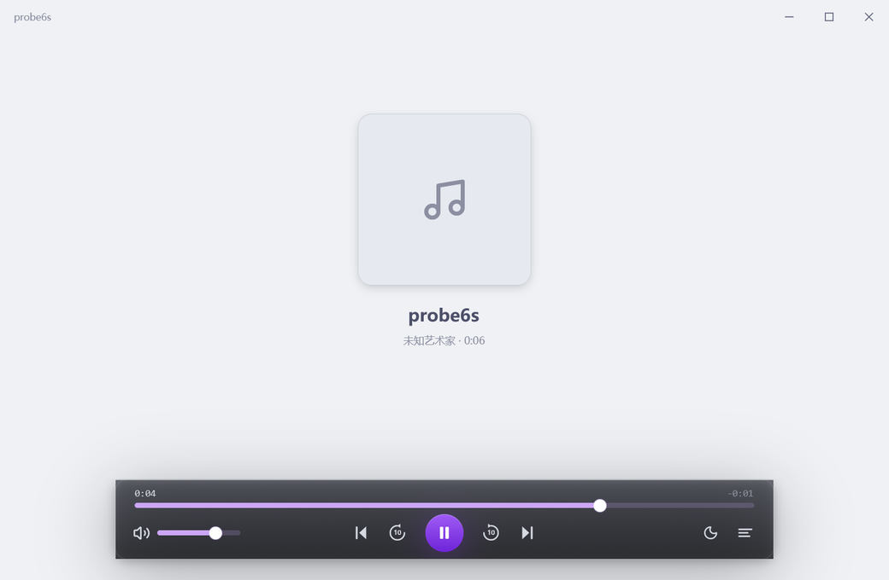
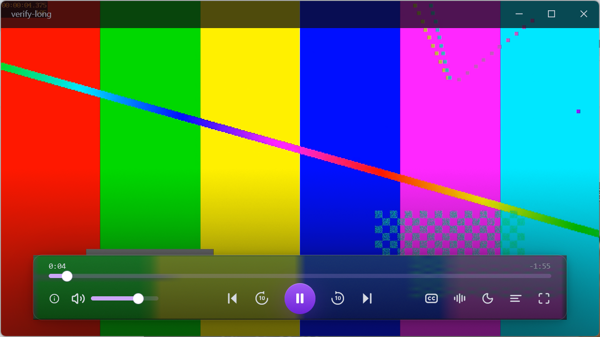
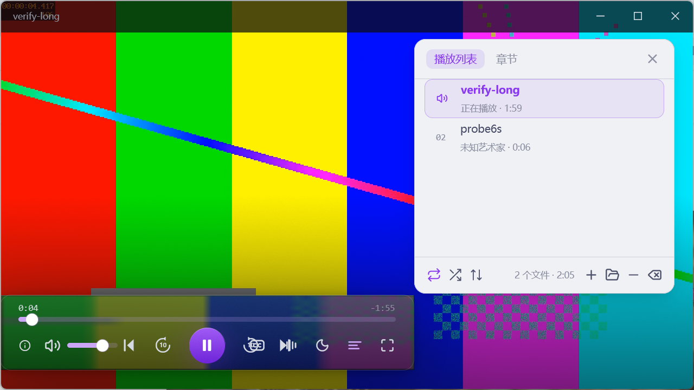
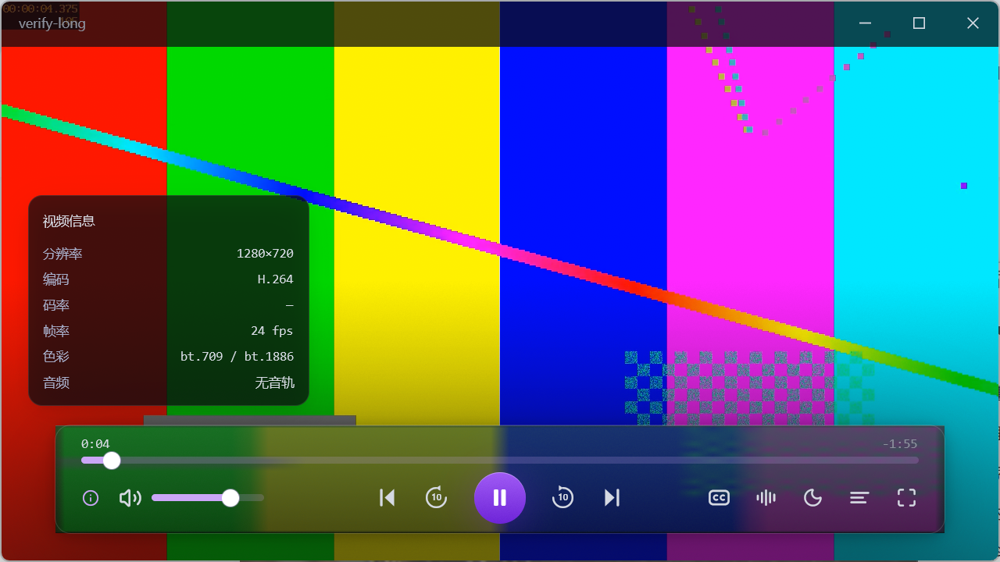

#  Simple Media Player

一个用 Rust + [GPUI Kit](https://gpui-kit.com) 写的轻量桌面媒体播放器：单窗口、原生渲染、启动快，
音频走 [rodio](https://github.com/RustAudio/rodio)，视频交给 mpv。

窗口标题用设计稿的产品名 **Vitrine**（仓库/二进制名沿用 `simple-media-player`）。
界面按设计稿的 **IINA 式沉浸布局**：内容占满窗口，控制条是一块悬浮的深色玻璃胶囊，
播放列表默认收起。应用表面严格对齐 **Catppuccin Latte** 色板（深色模式 **Mocha**），
强调色只用 **Mauve `#8839EF`** 一个；悬浮叠加层单独一套深色玻璃色值。两套映射都集中在
`crates/app/src/theme.rs`，改一处即整体换肤。



## 功能

| 能力 | 说明 |
|---|---|
| 音频播放 | MP3 / FLAC / WAV / OGG / M4A / AAC 等（rodio 解码） |
| 视频播放 | MP4 / MKV / WebM / MOV / AVI / TS 等（mpv 硬解 `hwdec=auto-safe`，帧经**软件渲染 API** 交给 GPUI 合成，见「架构」） |
| 播放列表 | 添加文件 / 递归扫描文件夹、拖拽排序、删除单曲、清空、双击播放；面板**悬浮在画面上**（不挤占画面宽度）、一键开合；展开时控制栏居中于剩余画面，行内带序号与「规格 · 时长」 |
| 播放模式 | 底部工具条三档：循环（关 / 列表循环 / 单曲循环）、随机、排序（加入顺序 / 标题 / 时长），全部随设置落盘 |
| 章节 | 面板「章节」页读 mpv 的 `chapter-list`：有章节就能点着跳，没有时直接说明 |
| 命令行直开 | `simple-media-player.exe D:\movie.mp4`（或 `--play <路径>`）加入列表并立即播放 |
| 拖放导入 | 从资源管理器拖文件/文件夹进窗口：入列表并立刻播第一个（文件夹递归扫描），**不弹提示**——画面换了就是回执 |
| 自动连播 | 一曲结束自动下一首；默认是「列表循环」（播完最后一首回到第一首），可切到「单曲循环」或「关」（播完末尾就停） |
| 进度与音量 | 拖动进度条跳转、音量 0–100 实时生效；**方向键** `←`/`→` 跳 5 秒、`↑`/`↓` 调 5% 音量 |
| 视频信息 | 胶囊左侧 `ⓘ` 展开一张 240×180 的信息卡（分辨率 / 编码 / 码率 / 帧率 / 色彩 / 音频），贴着画面左下、压在画面上；再点收起 |
| 字幕与音轨 | 胶囊右侧两个字轨键循环切换（`cycle sid` / `cycle aid`）；没有别的轨时标题带提示「没有其他字幕轨可切」 |
| 影院模式 | 视频播放时**双击画面**进入全屏播放（也可点胶囊里的全屏键 / 按 F11），退出有四个口子：`Esc`、再双击画面、右上角「最大化」、胶囊里的退出键；退出后自动恢复原窗口尺寸 |
| 窗口按画面定尺寸 | 起播时按 mpv 报的显示尺寸把窗口调成画面大小（放得下就 **1:1**，一个像素都不缩放），不留黑边；之后可以自由拉，不会被弹回去 |
| 圆角窗口 | 视频播放时窗体是圆角（Windows 11 的 DWM 圆角，画面本身也跟着圆），回到音频模式恢复直角 |
| 画面拖动窗体 | 按住画面拖拽即移动窗口（全屏时不拖）；双击标题栏仍是与系统一致的最大化/还原 |
| 明暗主题 | 右上角一键切换，配色全部走主题 token |
| 状态持久化 | 播放列表、上次曲目、音量、窗口尺寸自动保存 |
| 错误提示 | 文件损坏、格式不支持、libmpv 缺失等都有提示：音频模式走右上角 toast，视频模式走标题带胶囊 |
| 无障碍 | 所有图标按钮都有可读名称（`aria_label`） |



展开歌单时面板浮在画面右侧，画面宽度不变（右侧那条青色色条一直铺到窗口边缘）：



点胶囊左侧的 `ⓘ` 展开视频信息卡（再点收起）：



## 环境要求

- **Windows 10 / 11**（当前只验证了 Windows；GPUI Kit 本身跨平台，代码里 macOS/Linux 分支未测试）
- **libmpv-2.dll**（仅视频播放需要，进程内加载）。任选一种方式：
  - 用带视频支持的发布包（`scripts/package.ps1 -WithLibmpv` 已把 DLL 放在 exe 同目录）
  - 源码构建后跑 `scripts/fetch-libmpv.ps1 -CopyToExe`（自动下载 mpv-dev 并拷到 `target/debug`、`target/release`）
  - 自己放置：DLL 与 exe 同目录、或放进 PATH、或 `set SMP_LIBMPV_PATH=D:\tools\libmpv-2.dll`

音频功能不依赖 libmpv；DLL 缺失时视频区会显示明确提示，不影响其他功能。

> 注意：官方 `mpv.exe` 是**静态链接**的，拆不出 DLL。能进程内调用的只有 mpv-dev 构建里的
> `libmpv-2.dll`，`scripts/fetch-libmpv.ps1` 取的就是它（mpv 仓库的 Windows 构建）。

## 快速开始

```powershell
# 1. 拿到发布包后解压，直接运行
.\simple-media-player.exe

# 2. 首次使用：点右下角的列表按钮展开播放面板，用它右上角的「+」添加文件，或「📂」递归添加整个文件夹

# 3. 点列表项开始播放（列表默认收起，随时可再点列表按钮开合）
```

带 libmpv 的发布包（解压即用，无需另外准备 DLL）：

```powershell
powershell -ExecutionPolicy Bypass -File scripts/package.ps1 -WithLibmpv
```

> mpv / libmpv 采用 GPL（或 LGPL，取决于构建变体）许可，随包分发前请自行确认许可合规性；
> 不想带 GPL 组件时用 `scripts/fetch-libmpv.ps1 -Lgpl` 取 LGPL 变体。
> 默认打包（不加 `-WithLibmpv`）不含 DLL。

## 从源码构建

```powershell
cargo build --release -p simple-media-player
# 产物：target\release\simple-media-player.exe
```

开发运行：

```powershell
cargo run -p simple-media-player                 # 浅色主题启动
cargo run -p simple-media-player -- --dark       # 深色主题启动
cargo run -p simple-media-player -- D:\movie.mp4 # 打开即播（也支持 --play <路径>）
```

`--play <文件>` / 直接给位置参数等同于资源管理器的「打开方式」：文件会加进播放列表
（已在列表里就复用那一条）并立即开播。

## 测试

```powershell
cargo test --workspace
```

双轨测试：

- **`crates/player-core`**：纯逻辑与内核。包含真实 `libmpv-2.dll` 的端到端用例（起播 → 进度推进 → 暂停冻结 → 恢复/seek/音量 → 销毁），
  DLL 不存在时自动跳过而不是失败。
- **`crates/app/src/ui_tests.rs`**：`gpui_kit::test` 无头窗口 UI 集成测试。用原生指针事件点真实按钮，
  断言播放状态、进度条量程、无障碍名称、主题切换与控件不溢出窗口。

UI 测试把持久化目录重定向到临时目录（见 `persistence::set_config_dir_for_test`），不会污染真实配置。

还有一条真机验收：`python scripts/verify_floating_chrome.py`（需要先 `cargo build`）。它启动应用、
按 `SMP_UI_STATE` 探针算坐标去点真实按钮、抓屏取样，跑 17 项检查——画面出帧、窗口长成画面尺寸、
玻璃透色、歌单开合、`ⓘ` 信息卡、字幕/音轨 cycle、双击全屏与四个出口、按住画面拖动。

## 故障排查

| 现象 | 排查方式 |
|---|---|
| 视频区提示找不到 libmpv-2.dll | 跑 `scripts/fetch-libmpv.ps1 -CopyToExe`，或设 `SMP_LIBMPV_PATH` 指向 DLL |
| 视频打不开、日志只有一句 toast | 设 `SMP_MPV_LOG=%TEMP%\mpv.log` 后重试，libmpv 的真实报错在里面 |
| 想确认命令/事件是否正常 | 设 `SMP_MPV_TRACE=%TEMP%\mpv.log`，逐行记录发给 libmpv 的命令与事件 |
| 画面比例 / 黑边看着不对 | 设 `SMP_RENDER_TRACE=1`，每换一种尺寸打一行 `[render] frame WxH stage WxH native WxH scale S` |
| 想从外面看「界面以为自己在哪」 | 设 `SMP_UI_STATE=%TEMP%\ui.json`，应用每帧把画面区、chrome 矩形、淡出强度写成 JSON（验收脚本读的就是它） |
| 应用是否被外部结束 | 看 `%APPDATA%\simple-media-player\session.log`：有 `event loop returned` 是正常退出，只有 `start` 说明被强杀 |
| 播放失败但界面上只闪了一下提示 | 同一条错误也写进了 `session.log`（`error: 无法播放「…」…`），可以直接翻日志 |

> 发布版是 GUI 子系统程序，**双击 exe 不会带出一个黑底 cmd 窗口**；代价是它没有控制台，
> 所以诊断信息除了弹 toast，还会同时落到 `session.log`。调试构建保留控制台，`eprintln!` 直接可见。

> 踩过的坑：`playlist.json` 里写成 `C://Users//...`（双斜杠）会导致 mpv 报 `loading failed`，
> 应用会提示「mpv 无法加载该文件」。路径用标准 `C:\Users\...` 即可。

## 数据与日志

配置目录：`%APPDATA%\simple-media-player\`

| 文件 | 内容 |
|---|---|
| `playlist.json` | 曲目列表 + 上次播放位置 |
| `settings.json` | 音量、窗口尺寸 |
| `session.log` | 启动 / 退出 / panic / 播放失败原因留痕（用于区分「主动退出」与「被外部终止」） |

设环境变量 `SMP_DATA_DIR=<目录>` 可以把整个配置目录挪走（便携模式 / 自动化）：
截图脚本和拖放验收都靠它跑在临时目录里，免得写坏你正在用的播放列表。

## 架构

```
crates/
├── app/                 # GPUI 应用：窗口、视图状态、播放列表
│   ├── player_view.rs   # 主区域 + 底部控制栏 + 双引擎路由 + 100ms 状态轮询
│   ├── video_surface.rs # 一帧 BGRA → GPUI 纹理（含 48×20 模糊缩略图、旧图退役）
│   ├── ui_state.rs      # 画面上 chrome 的几何唯一真相（chrome_rects）+ 验收探针
│   ├── playlist.rs      # 列表 delegate（虚拟滚动、拖拽排序）
│   ├── theme.rs         # 设计稿色板 → gpui-component 主题 token（Latte / Mocha）
│   └── persistence.rs   # 配置与会话日志
└── player-core/         # 播放内核（无 UI 依赖）
    ├── audio.rs         # rodio：play/pause/seek/volume
    ├── video.rs         # 进程内 libmpv：起播、属性观察、出帧
    ├── render.rs        # mpv 软件渲染 API → BGRA 帧缓冲（取色 / 缩略图）
    └── metadata.rs      # lofty 元数据、目录扫描
```

### 视频画面怎么进 GPUI 渲染树

GPUI 的 Windows 后端是 DirectComposition（`WS_EX_NOREDIRECTIONBITMAP`），**窗口里塞不下原生子窗口**。
所以曾经只有一条路：另开一个 `WS_POPUP` 顶层窗、mpv 用 `--wid` 直接画上去。那张账单很长——主窗口
要垫在画面上面并逐像素透明、再用 `SetWindowRgn` 把画面区从自己身上挖掉（被完全遮挡的窗口不出帧）、
chrome 得 `RGN_OR` 加回区域、z 序每帧对账、鼠标事件靠 wndproc 里 `SetForegroundWindow` 兜着；而且
区域一空窗口会从 DWM 合成树里消失。代价最大的一条是**区域级 backdrop blur 拿不到**（acrylic 只能整窗，
糊的是窗口背后的桌面），玻璃质感永远差一层。

现在用 mpv 的**软件渲染 API**，画面就是 GPUI 自己的一张图：

1. `mpv_render_context_create` 带 `MPV_RENDER_PARAM_API_TYPE = "sw"`，**必须同时 `vo=libmpv`**
   （默认的 `vo=gpu` 要一个真窗口，只会清成黑色并只回调一次）；`video-timing-offset=0` 让
   `render` 不等显示时刻、不阻塞 UI 线程；
2. update 回调跑在 mpv 的线程上、**不能在里面调 mpv API** → 只 `try_send` 进
   `async_channel::bounded(1)`（天然合并成「有帧了」），由 GPUI 的前台任务取出来出帧；
3. 主线程调 `mpv_render_context_render` 拿 `bgr0`（第 4 字节是垃圾，必须补 255）→
   `RenderImage` → `ImageSource::Render` → `gpui_kit::img(...)`；展示完调 `window.drop_image()`
   让图集回收（留 2 帧退役队列，避免正在显示的那张被释放）；
4. 送进去的尺寸走纯函数 `render::fit_render_size`：contain 适配、**只缩不放**、上限 2560×1440
   （每帧都是新 `ImageId`，超大图会把图集吃满）；
5. 画面在合成树里之后，chrome 就是普通子节点叠在上面，同一帧缩到 48×20 当模糊底
   （GPU 双线性 ≈ 大半径 box blur），L3 才真的成立；拖动/双击也回到普通元素手势。

删掉的东西：`video_overlay.rs`（1010 行）、区域打洞、z 序对账、`WS_EX_TRANSPARENT` 实验、
以及「视频窗铺主窗矩形还是客户区」那一串几何坑。播放控制仍走 libmpv 的 C API（进程内，无 IPC）。

### 最大化 / 还原为什么自己实现

`Window::zoom_window()` 的文档写的是 "Toggle zoom on the window"，但 Windows 后端的
实现只有 `ShowWindowAsync(SW_MAXIMIZE)`（`gpui-pre-windows 0.3.9` 的 `zoom()`），
**没有还原分支**——最大化之后再点那个按钮完全没反应。

所以 `window_actions` 自己用 `IsZoomed` + `ShowWindowAsync(SW_MAXIMIZE / SW_RESTORE)` 切换：

- 必须是 **Async**。同步的 `ShowWindow` 会在 GPUI 的事件派发内部重入 `WM_SIZE`，
  而 GPUI 这一层不会因此重新布局——窗口真的变成 3840×2088，界面还画在 1040×680 上，
  右边一大片空白、hitbox 全部错位，于是「再点一次」永远点不到按钮。
- 代价是命令异步生效，调用后 `IsZoomed` 还是旧值，所以状态先乐观更新，
  100ms 的 tick 里再校正（用户用 Aero Snap / Win+↑ / 双击标题栏改状态时也靠它发现）。
- 双击标题栏本身不需要我们处理：标题带右侧的拖拽区映射成 `HTCAPTION`，
  最大化/还原由 Windows 原生完成。

顺带修掉一个持久化问题：最大化时窗口尺寸不再被当成「用户尺寸」写进设置
（以前最大化后等 5 秒，下次启动就会按最大化尺寸开窗）。

### 窗口为什么仍然逐像素透明

画面已经自己铺了黑底（含信箱黑边），所以「透出桌面」的只剩两处：玻璃的 alpha，和圆角外侧那四个角。
两件事缺一不可：

1. `WindowOptions.window_background = Transparent`；
2. 把 gpui-component `RootPlugin` 给窗口表面 refine 的那层 `.bg(tokens.background)`
   逐窗覆盖掉（`Root` 实现 `Styled`，在 `render` 里做一次；`new` 那会儿 `Root` 还没挂上）。

画面区再也不会「被主窗口盖住所以停止出帧」——那种病是 `--wid` 方案的专属，随叠加窗一起消失了。

`chrome_layout()` 仍然把标题带/胶囊/信息卡/歌单/底部遮罩的矩形算出来（`ui_state::ChromeLayout`），
但**用途变了**：不再是给 `SetWindowRgn` 递刀子，而是①`hidden_chrome_leaves_no_rects` 这类单测，
②验收脚本的 `SMP_UI_STATE` 探针（点击坐标、淡出判定都读它）。

### 窗口尺寸为什么等于画面尺寸

起播时窗口会**自动长成画面的大小**，这样画面正好铺满客户区、四边没有黑边。三个要点：

1. 尺寸取 mpv 的 **`dwidth`/`dheight`**（显示尺寸，已按像素宽高比和旋转校正），
   不是 `width`/`height`（编码尺寸）——后者碰到变形宽银幕会把画面拉扁；
2. 策略收在纯函数 `window_actions::plan_fit`：放得下就 **1:1**，屏幕放不下等比缩进工作区，
   缩到比窗口最小尺寸还小就反过来放大；位置以当前窗口中心为锚点并夹回工作区。
   纯函数才有单测（5 条，`cargo test -p simple-media-player`）；
3. mpv 的 `dwidth` **会先报一个假值**（1280×720 的片子先报 960×540），所以同一个尺寸
   连着报两次才真正动窗口，避免肉眼可见的两次跳变。

`SetWindowPos` 不能直接在 `Context::update` 里调：它会同步派发 `WM_SIZE` → 重新布局，
而那一刻 `App` 正被本轮更新借用，布局会停在旧尺寸、hitbox 全错位。所以这条命令丢进
`cx.spawn_in(...)` 的前台任务，在下一轮消息循环里执行。

双面胶：窗口尺寸**不在视频模式下持久化**（那份尺寸是算出来的，存下来会让下次启动的
音频模式跟着某部片子的比例走）。

### 圆角为什么要自己设

视频模式整个窗口是圆的（画面直接铺到边）。进视频模式时给主窗口设
`DwmSetWindowAttribute(DWMWA_WINDOW_CORNER_PREFERENCE, DWMWCP_ROUND)`，退出时改回
`DWMWCP_DONOTROUND`（音频模式保持原来的直角）。窗口是逐像素透明的，被 DWM 切掉的四个角
自然透出桌面。

不用 `SetWindowRgn` 自己切：区域是 1 bit 的，边缘必然是锯齿；DWM 这条属性是系统按 DPI
算好半径再抗锯齿，也就是 Windows 11 上其它窗口的样子。Windows 10 没有这条属性，调用被
静默忽略、窗口保持直角。

### 按住画面拖动 / 双击全屏

画面现在是 GPUI 里的一个普通元素（`.id("video-surface")`），手势直接在元素上接，
不再有第二个窗口的 wndproc：

- `on_mouse_down(Left)` 记下「光标屏幕坐标 + 窗口左上角」，再起一个 8ms 的循环读
  `GetCursorPos`、按差值 `SetWindowPos`（`SWP_NOSIZE | SWP_NOZORDER | SWP_NOACTIVATE`），
  `on_mouse_up` 清锚点。不用 `Window::start_window_move()`——**Windows 后端没有实现**；
  也没有 `SendMessageW(main, WM_NCLBUTTONDOWN, HTCAPTION)` 这条捷径（GPUI 自己的 wndproc
  会吃掉后续的 `WM_MOUSEMOVE`，系统模态拖动只跟上头一两步就停住）。
- 双击 → **全屏播放**（不是最大化）：`on_double_click` 先清锚点再调 `set_cinema`。
  这次能直接收到双击，因为窗口是正常激活的 GPUI 窗口——以前叠加窗是 `WS_EX_NOACTIVATE`，
  系统对没激活过的窗口只连发 `WM_LBUTTONDOWN`，`WM_LBUTTONDBLCLK` 压根不来，只能自己按
  `GetDoubleClickTime` + `SM_CXDOUBLECLK` 判。
- `on_double_click` 只挂在 `Stateful<Div>` 上（元素必须有 `.id()`），普通 `Div` 没这个方法。
- 全屏 / 最大化 / 非视频模式下不拖窗体（画面本来就铺满）。

### 全屏播放的四个出口

`Esc` / 再双击画面 / 右上角「最大化」/ 胶囊里的退出键，四条路都走同一个
`PlayerView::set_cinema(false, …)`：

| 出口 | 实现 | 注意 |
|---|---|---|
| `Esc` / `F11` | `App::intercept_keystrokes` | 不能用 `bind_keys` + `on_action`：没有焦点元素时 GPUI 把按键派发给 dispatch 树的**根**，那是 gpui-component 的 `Root`，挂在视图根节点上的 `on_action` 永远收不到 |
| 再双击画面 | 元素上的 `on_double_click` | 见上 |
| 右上角「最大化」 | `toggle_maximize` 里先判 `cinema` → 退影院 | 全屏时 GPUI 已摘掉 `WS_MAXIMIZEBOX`，这时再 `SW_MAXIMIZE` 只会卡在错乱态 |
| 胶囊里的退出键 | `exit-cinema` 按钮 | 影院模式下标题带右侧会多出这个键 |

**坑：进出全屏那一下 GPUI 会把自己的尺寸通知丢掉。** `WM_SIZE` 是在 `SetWindowPos`
里**同步**派发的，此时 App 正被本轮 `update` 借用，GPUI 的 resize 回调里
`handle.update()` 拿不到借用权（`log_err` 之后静默失败，连日志都没有）。结果是布局停在
旧尺寸——画面铺满整屏，顶栏却只画在左上角 853×34 那一小块里、右上角的窗口按钮根本不存在，
点哪里都没反应（`Esc` 还灵，因为键盘不走命中测试）。

**而且 `window.bounds()` 也可能一起假**：全屏这条路径上 GPUI 的 `logical_size` 根本没更新，
`bounds()` 和 `viewport_size` 双双停在旧值，只比它俩永远发现不了。真实值只能问系统：
`window_actions::client_size()`（`GetClientRect`）——所以判据有两条，`viewport ≠ bounds`
（普通改尺寸）**或** `bounds ≠ 真实客户区`（进出全屏）。

`refresh()` 治不好（它不碰 viewport，只是标脏），`bounds_changed(cx)` 更不能直接调
（会把 `bounds_observers` 全跑一遍，其中就有对本视图的 `update` → panic
「cannot update PlayerView while it is already being updated」）。可用的是给窗口
**补一条 `WM_SIZE`**（`window_actions::kick_layout`，`PostMessage` 到消息循环里，
lparam 用真实客户区尺寸）：GPUI 的尺寸处理只认 lparam、是幂等的，重放一次布局就按
新尺寸重排。tick 里每 100ms 对一次账，不一致就补一条（300ms 限流）。

### 方向键：`←`/`→` 跳 5 秒、`↑`/`↓` 调 5% 音量

和 `Esc` 一样挂在 `App::intercept_keystrokes` 上，原因不是图省事，而是**没有别的地方能挂**：
gpui-component 0.7.3 的 `Slider` 没有 `FocusHandle`、也不参与键盘（上游硬限制），
焦点永远落不到进度条/音量条身上，只能在这一层接。

| 键 | 动作 | 说明 |
|---|---|---|
| `←` / `→` | −/+ 5 秒 | 走带上的 ±10 秒按钮是粗调，方向键是微调（和 mpv / IINA 一致） |
| `↑` / `↓` | +/− 5% 音量 | 20 档，从静音按到满不会手酸，也不会一按就跳过头 |

三处细节：

- **音量必须同时写 `SliderState`**。`volume_pct` 只是镜像，拇指位置在
  `SliderState` 里；只改镜像字段的话声音变了、圆点不动，看起来像没反应。
  反过来 `SliderState::set_value` **不会**发 `SliderEvent::Change`，所以引擎与
  持久化那一步还得自己调一次。
- **没有曲目时不吞左右键**：留给将来把方向键给列表导航。
- **播完之后引擎是 `Stopped`，`seek` 在那一刻是空操作**（sink 空了，没有可 seek 的
  东西），方向键会变成「按了没反应」。这条路径改走 `AudioEngine::play_at`
  （重新起播并落到目标位置）；视频播完 tick 会退出视频模式，用音频引擎重起一个
  mp4 只会解码失败，所以视频的「播完再往回跳」这一版不做。

### 控制栏 v3：固定 760 宽的胶囊 + `ⓘ` 信息卡 + 两个字轨键

胶囊不再是「铺满整宽减两个内缩」，而是**固定 760×92、水平居中**——设计稿里它是
画面下方的一条窄带，两侧要留出画面：

| 元素 | 几何 | 备注 |
|---|---|---|
| 胶囊 | 760 × 92（内容撑高，实测 92） | 距窗口下沿 24、圆角 14、padding 20/12 |
| 进度行 | `当前时间 │ 轨道 596 │ -剩余时间` | 时间**夹**在轨道两端，比"轨道一行、时间一行"少 16px |
| 控制行 | 左：`ⓘ` + 音量条 96；中：走带 5 键；右：字幕/音轨/列表/全屏/主题 | 左右两栏 `flex_1`，中间那栏才落在正中间 |
| 信息卡 | 240 × 180，浮在胶囊上方 16 | 贴画面左下 x24，`ⓘ` 展开/收起 |

三处必须记住的：

- **信息卡要进 `chrome_layout()`**。它现在是普通子节点，视觉上一定画得出来；进几何表是为了
  两件事：淡出时一起让位（否则透明卡片照样吃点击），以及验收脚本能在它上面取点。
  `ui_tests::info_card_toggles_and_is_carved_out` 守着「开了就多一块、关了少一块」。
- **卡片里的值要能截断**。mpv 的 `video-codec` 报的是并列别名
  （`h264 (High) / AVC / MPEG-4 AVC / MPEG-4`），整串塞进 240 宽的卡会直接冲出右边。
  取第一段（`short_codec`）再给值加 `min_w_0 + truncate`；单段测试见
  `codec_string_keeps_only_its_first_alias`。
- **没有音轨就说「无音轨」**，不要留 `—`：`—` 会被读成"还没读到"，而这件事是确定的
  （`audio-codec` / 声道 / 采样率全空）。码率 `—` 才是真的读不到（mpv 对部分容器
  报 `unavailable`）。

字幕/音轨键走 `cycle sid` / `cycle aid`。mpv 的 `cycle` **没有返回值**，素材只有一条
轨时它什么也不做，界面上「点了没反应」和「切到了」长得一样——所以切换前记下轨号，
下一轮 tick 比对观测值：变了报新轨，800ms 没变就明说「没有其他字幕轨可切」，
落在标题带胶囊上（视频模式的即时反馈统一在那里）。

### 拖放

一条路径：GPUI 自己的 `IDropTarget`（注册在主窗口上）。`.on_drop::<ExternalPaths>(...)`
挂在根节点上，整窗都是投放区——画面区也在主窗口里，所以不再需要「叠加窗自己收
`WM_DROPFILES`」那套补丁。

落地后统一走 `PlayerView::import_dropped`：文件夹递归扫描 → 按 `path_key`
（`\` 与 `/` 归一化）去重 → 追加进列表 → 播第一个。

拖拽过程中的提示是「全窗压暗 + 居中卡片」，两种模式同一份实现——画面在合成树里之后，
它不会再被盖住，也没有必要为视频模式单独挪位置。

## 视觉规范（对齐设计稿）

设计稿（Ardot `737444551354649`）定的是 **IINA 式沉浸布局**：画面/封面占满窗口，
控制条是一块悬浮的深色玻璃胶囊，播放列表默认收起、需要时浮在画面右侧。

### 两套色板（不要混用）

| 层 | 取色依据 | 用在哪 |
|---|---|---|
| **应用表面** | Catppuccin **Latte**（深色 **Mocha**） | 窗口底、悬浮歌单面板 |
| **叠加层** | 深色玻璃 `#0B0C10` @72% + 白 10% 描边 | 悬浮胶囊与其上的一切控件 |

叠加层是**故意不跟主题走**的：它浮在视频画面之上，必须永远偏深，否则浅色主题下
白底控制条会糊在亮画面上（OSC 的通用做法，IINA 同样如此）。`theme.rs` 的
`overlay` 模块集中提供这组颜色（`canvas` / `glass` / `border` / `fg` / `dim` /
`accent` / `play`），界面代码不写死色值。

这层玻璃是**真的半透明**：画面就在同一个合成树里，72% 的深色底会真的透出画面色相
（验收脚本取两个不同色条处的胶囊像素做色差判定），模糊底是同一帧降到 48×20 再拉伸的。

质感分四层（`design/spec.json → texture_layers`）：L1 玻璃本身（竖向渐变 + 白 14% 描边 +
两条 1px 内描边 + 双层阴影 + 底部 240 高渐隐）、L2 取画面**色相**染色（S 46% / L 36%，
α .26/.08，只取色相不取明度，8° 迟滞避免闪）、L3 上述降采样模糊、L4 **液态玻璃**
（`liquid_glass.rs`：体部 σ=30 / 边圈 σ=7 两档模糊，边缘带沿圆角矩形法线朝外位移最多
6.5px（歌单 7px），压暗按底子亮度自适应——暗底压暗、浅底铺奶白）。

L4 是默认档。它的贴图按**屏幕 1:1 的物理像素**烘焙（单块面 22 万像素封顶），圆角的
alpha 过渡固定 1 个物理像素——圆角是曲率，比直边更吃分辨率，半分辨率放大时弧上只剩几个
采样点，看着就是阶梯。

控制层退场时（视频在播、2.5s 没有输入），这张贴图还有**第二道 pass**：胶囊散成 340 颗
光尘。粒子不走第二条通道——加光在 GPUI 的层叠里没有逐节点入口，在 BGRA 里就是逐像素
加法；而粒子与玻璃在时间上不重叠（胶囊 .18s 淡完，粒子散到 .64s），同一张贴图分时复用。
退场期间玻璃 pass 走缓存（首帧 4.7ms、缓存帧 0.23ms），只有粒子在逐帧写。

应用表面的语义 token（`theme.rs` 把设计稿色板翻译成 gpui-component token）：

| 角色 | Token | Latte | 用在哪 |
|---|---|---|---|
| 墙体 | `background` | `#EFF1F5` | 窗口底、悬浮歌单面板 |
| 次级面 | `muted` / `secondary` | `#E6E9EF` | 封面占位、ghost 悬停底 |
| 分隔线 | `border` | `#CCD0DA` | 面板描边、列表分隔 |
| 主文案 | `foreground` | `#4C4F69` | 标题、面板中的曲名 |
| 辅助文案 | `muted_foreground` | `#8C8FA1` | 编号、时长、提示 |
| 强调 | `primary` | `#8839EF` | 播放按钮、当前曲目 |

深色模式用同一结构的 **Mocha**（`#1E1E2E` / `#CBA6F7`），叠加层进度与音量用
Mocha Mauve `#CBA6F7`，播放键仍是品牌色 `#8839EF`。

### 尺寸

所有数值的唯一来源是 `design/spec.json`——改任一条都要同步 `scripts/verify_floating_chrome.py`
里的常数（脚本按几何取像素，对不上就报假失败）。

概览：标题带 **34px**（自绘拖动区 + 最小化/最大化/关闭，窗口按钮 **46 宽 × 标题栏高**，字形是
手写 10×10 SVG）、控制胶囊 **760×92**（距下 24、圆角 14、padding 20×8，细节见「控制栏 v3」）、
播放列表 **320px** 宽（顶部 = 标题带 + 8、右侧 24、底部 119）、播放按钮 **44 正圆**、
底部渐隐带 **118**、正文字号 13 / 辅助 11 / 时间码用等宽 10。控制行分三段，
左右两栏等宽（`flex_1`）**中间走带控制才恒在正中**（`transport_controls_are_horizontally_centered`）。

窗口按钮不能沿用 `xsmall` 图标按钮（20×20）——Windows 的点击热区就是 46 宽整块，图标 10px，
悬停铺满底色、关闭键用系统红 `#C42B1C`。

标题带的前景色**跟着底色走**，不跟主题走：视频模式下这条带压低在画面上的深玻璃
（`overlay::glass()`），若还取浅色主题的 `muted_foreground`，对比度只有 3:1 左右，
曲名和窗口按钮几乎看不见（`chrome_fg` / `chrome_dim`）。

提示（toast）分两种呈现，按**底色**而不是按内容选：

| 模式 | 呈现 | 位置 |
|---|---|---|
| 音频 | gpui-component 通知层（会自己排队、可手动关） | 右上角，让开标题带 12px，宽 320 |
| 视频 | 标题带里的小胶囊（浅色文案 + 状态图标，4s 自动退场） | 标题带右侧、窗口按钮左边 |

原因是视频模式整块是深色画布，右上角的通知层会盖在画面上、和玻璃胶囊打架；
标题带里那枚小胶囊读起来更轻，也不挡画面。
通知层的默认位置（`TITLE_BAR_HEIGHT + 16`）会贴住窗口按钮下沿，宽度 382 在 1040 窗口里
占 37%，所以 `theme::install` 里把 `margins.top` 改成「标题带 + 12」、宽度收到 320。

### 字体

界面字体取**系统自带**的那一套，不跟设计稿硬绑：

| 平台 | 正文字体 | 等宽（时间码/序号） |
|---|---|---|
| Windows | `Microsoft YaHei UI` | `Consolas` |
| macOS | `PingFang SC` | `Menlo` |
| 其他 | `Noto Sans SC` | `DejaVu Sans Mono` |

设计稿（Ardot）写的是 Inter / Noto Sans SC，但这两套 Windows 都不预装。之前写死
`Noto Sans SC`，本机装过看着正常，发行包到别人机器上字体解析失败会退到系统兜底——
中文常落到宋体，11px 下横细竖粗、笔画发糊。微软雅黑是 Vista 起自带的中文 UI 字体
（`…UI` 是它的紧凑变体），资源管理器/设置页本身就是这套，中英混排最稳；
用例 `ui_font_is_a_system_font_not_a_design_tool_font` 守着这个决定。

### 应用图标

`assets/vitrine.ico` 由 `scripts/make-icon.py` 生成（品牌 Mauve 圆角方块 + 白色播放三角，
和界面里那颗播放按钮同一个符号），多尺寸 16…256，改品牌色只改脚本。

`crates/app/build.rs` 用 `embed-resource` 把它以 **ID = 1** 写进 exe 的 PE 资源，
并附带 VERSIONINFO。ID 必须是 1：GPUI 的 Windows 后端注册窗口类时调的正是
`LoadImageW(module, MAKEINTRESOURCE(1), IMAGE_ICON, …)`，拿不到就没有窗口图标，
任务栏和 Alt+Tab 会显示系统占位图。找不到 `rc.exe`（没装 Windows SDK）时只告警、不失败。

### 与设计稿的差异

画面已经进了 GPUI 的合成树，玻璃能真的透出画面了，剩下这些还差一点：

1. **毛玻璃是「降采样 + 双线性」而不是真 backdrop blur**：设计稿的标题带/胶囊是
   「60% 黑 + 32px 模糊」。`WindowBackgroundAppearance::Blurred` 走不通（Windows 后端映射到
   `SetWindowCompositionAttribute` 的 acrylic，糊的是窗口**背后**的桌面）；mpv 的 render API
   也不给模糊。现在的做法是把同一帧降到 **48×20** 当底图拉伸——GPU 双线性插值等价于大半径
   box blur，观感接近，但大块纯色边界会比设计稿软一点。真模糊要自己起一条 GPU 管线（或
   gaussian 的 CPU 版，1080p 每帧不值得），暂不做。
2. **歌单面板保持应用表面色（Latte 浅底）**：它压在画面上，用深色玻璃的话列表行的文字色
   得跟着换一套（`List` delegate 取的是主题 token），当前以可读性优先。

另外设计稿控制行右侧的 CC（字幕开关）/ 设置 / PiP 在本版本没有对应功能，因此不画；
音轨与字幕是「循环切轨」（`cycle aid` / `cycle sid`），不是开关。

## 已知限制

- **每一帧都要上传一张纹理**：`RenderImage` 每帧是新 `ImageId`，Windows 的 DirectX 图集按
  `(image_id, frame_index)` 分配 tile（最大 16384²），所以送到渲染的尺寸被 `fit_render_size`
  压到 2560×1440 以内、显示过的图立即 `drop_image()`（保留 2 帧退役队列）。4K 片子是
  「解码 4K、送 1440p」，不是点对点；要真 4K 得换共享纹理/D3D11 互操作。
- **软件渲染走 CPU**：`vo=libmpv` 意味着 mpv 先把帧读到内存（`bgr0`）再由我们上传，1080p
  在普通台式机上够用，但比 `--wid` 的零拷贝多一次往返。
- **进度条与音量条的键盘操作绕过了组件**：上游 `Slider`（`gpui-component` 0.7.3）既无
  `FocusHandle` 也无 AccessKit 角色/值，键盘焦点到不了它身上。`←`/`→`、`↑`/`↓` 是在
  `App` 级拦截里实现的，所以**拖到一半松开鼠标那类精细操作仍只有鼠标能做**；容器已补
  `aria_label` 作为分组名。
- **视频播完后不能靠方向键倒回去**：mpv 是 `--keep-open=no`，播完会把文件卸掉，此时
  `seek` 无效；这一版只做了音频的「播完从目标位置重新起播」。
- **mpv 需要外部提供**：默认发布包不包含 DLL，用 `-WithLibmpv` 打包。
- 播放列表拖拽排序依赖列表组件内建行为，列表项无键盘重排快捷键。

## 许可

代码 MIT。依赖遵循各自许可（GPUI Kit / GPUI 为 Apache-2.0，rodio MIT，mpv GPL）。
